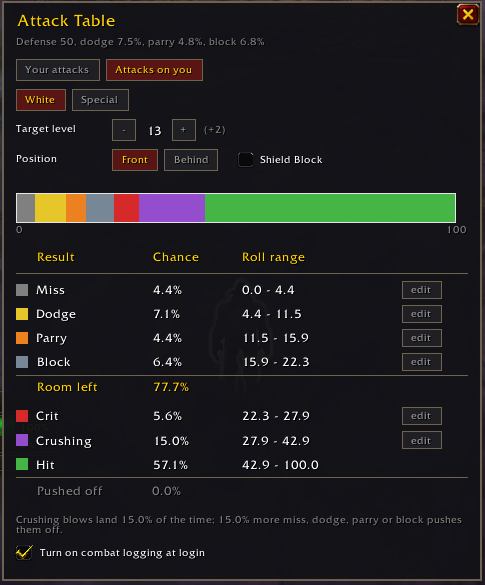

# Attack Table

A World of Warcraft addon that draws the melee attack table as one colored bar, in the order the game rolls it: miss, dodge, parry, glancing, block, crit and hit. It shows how much room is left for crits, and how much is pushed off the end when the table is full.

## Features

- **Your attacks:** your melee or ranged attacks on a monster, for white swings or special attacks, from the front or from behind, with the main hand or off hand.
- **Attacks on you:** a monster's attacks on you, with crushing blows and Shield Block, for tanks.
- **Target level:** pick any level from 1 to 63 to see how the table changes against higher or lower monsters.
- **Your own stats:** reads your weapon skill, hit, crit, defense, dodge, parry and block from the game and updates as your gear, buffs or talents change.
- **Edits:** any chance can be edited by hand to try out a different number.
- **Combat logging:** an optional checkbox turns on the game's combat log at every login.

## Games

- WoW Forever
- WoW Classic Era

Each game uses its own rules.

## Installing

Copy the `.lua` and `.toc` files into `World of Warcraft/<game folder>/Interface/AddOns/AttackTable/`, then restart the game.

## Using it

- Click the sword button on the edge of the minimap, or choose Attack Table in the minimap's addon menu.
- Or type `/attacktable`.
- Drag the minimap button to move it around the minimap. `/attacktable minimap` hides or shows it.
- Hover over any row or slice of the bar to see how its chance was worked out.

## License

GPL-3.0; see [LICENSE](LICENSE).
